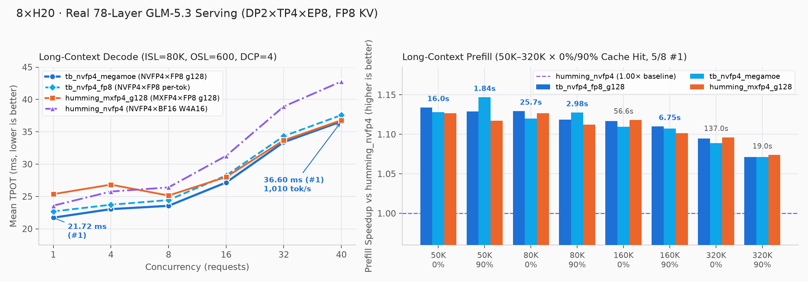
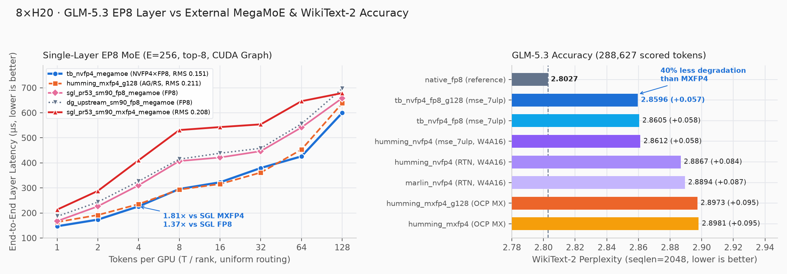
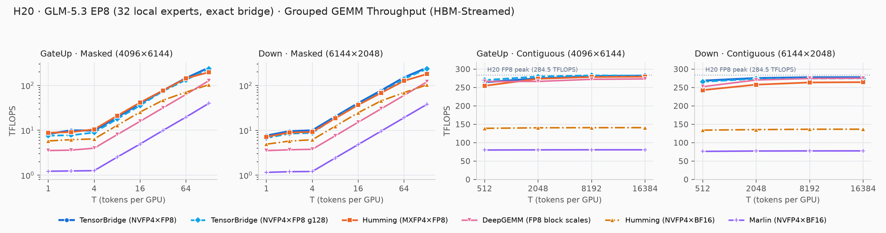
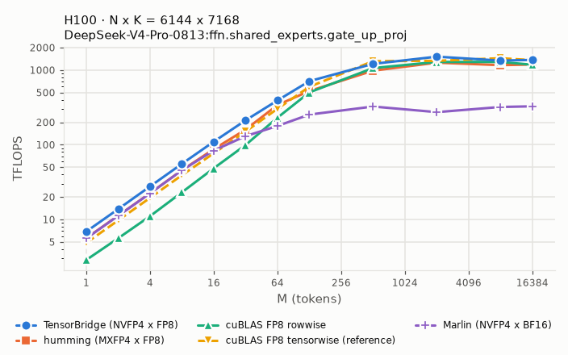
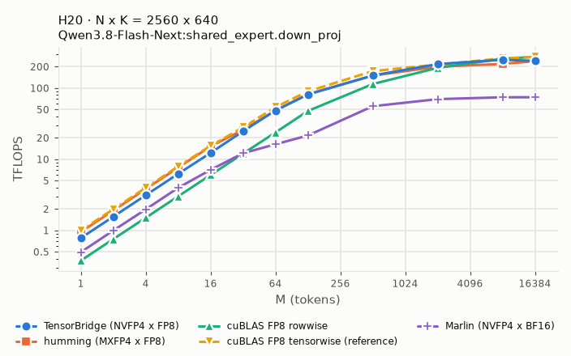

# TensorBridge

TensorBridge is a Hopper (`sm_90a`) W4A8 GEMM and Expert-Parallel MoE library that keeps weights in
NVFP4 (E2M1 codes, one E4M3 scale per 16 values, and a per-tensor FP32 scale) and executes them on
Hopper's FP8 tensor cores. Each weight is dequantized in registers to FP8 by a short bridge (`exact`
for standard NVFP4 checkpoints, or `fpma` for FPMA-aware checkpoints) and fed to WGMMA against FP8
E4M3 activations (`group-128` by default, or `per-token`).

It covers dense linear layers, MoE grouped GEMMs (`indexed`, `contiguous`, and `masked` layouts) with
fused `GateUp + SwiGLU + FP8` epilogues and adaptive multi-token Prefill, and a **zero-dependency
MegaMoE** runtime built directly on PyTorch symmetric memory (no DeepEP or NVSHMEM required). Its
zero-patch vLLM 0.32 plugin serves both pre-quantized NVFP4 checkpoints and block-128 FP8 MoE
checkpoints via on-the-fly GPU conversion (`mse_7ulp`, cutting 4-bit PPL degradation by **40%** vs
OCP MXFP4 with zero runtime cost).

It is the kernel library of the USENIX ATC '26 paper *TensorBridge: Bridging Microscaled FP4 Weights to FP8 Tensor
Cores for LLM Serving*. The paper's artifact (evaluation scripts and the vLLM fork it used) is at tag
[`atc26-ae`](https://github.com/revollllt/atc26-tensorbridge/tree/atc26-ae).

## Performance

### Real 78-Layer GLM-5.3 Serving & EP8 MegaMoE (8×H20, vLLM 0.32)

On an 8× NVIDIA H20 node (`DP=2, TP=4, EP=8`, FP8 KV cache, GLM-5.3 FP8 checkpoint):
- **Long-Context Decode (`80K + 600`, `DCP=4`)**: `tb_nvfp4_megamoe` ranks **#1 at all 6 concurrencies
  (`C=1..40`: `21.72–36.60 ms` TPOT, `1,010 tok/s` at `C=40`)** while saving **+3.25–4.18 GiB** of KV
  cache capacity over AG/RS workspaces.
- **Long-Context Prefill (`50K–320K × 0%/90%` cache hit)**: `tb_nvfp4_fp8_g128` and `tb_nvfp4_megamoe`
  win **5/8** workloads (remaining 3 within `0.12%–0.25%` of `humming_mxfp4_g128`) and outperform
  W4A16 `humming_nvfp4` by **6.7%–13.4%**.
- **Single-Layer EP8 MoE & Accuracy**: `tb_nvfp4_megamoe` beats `sgl_pr53_sm90_mxfp4_megamoe` by
  **1.13×–1.81×** and `sgl_pr53_sm90_fp8_megamoe` by **1.10×–1.38×** across `T=1..128` (uniform, CUDA
  Graph). On full-model accuracy (`mse_7ulp`), `tb_nvfp4_megamoe` and `tb_nvfp4_fp8_g128` achieve
  **2.8610 / 2.8596** WikiText-2 PPL (`+0.058 / +0.057` vs native FP8 `2.8027`, **38%–40% less
  degradation** than `humming_mxfp4_g128` `2.8973`), and on vLLM's upstream 5-shot GSM8K
  (`tests/evals/gsm8k/gsm8k_eval.py`, N=1,319), `tb_nvfp4_megamoe` ranks **#1 in both accuracy
  (`92.04%` vs native FP8 `91.43%`, `+1.74 pp` over `humming_mxfp4_g128` `90.30%`) and throughput
  (`1,089.5 tok/s`, `1.39×` vs `humming_mxfp4_g128`)**.




### Kernel Microbenchmarks (H20 Grouped MoE & H100/H20 Dense FFN)

HBM-streamed (L2-rotated) CUDA-Graph single-GEMM throughput on GLM-5.3 EP MoE shapes (H20, `--bridge exact`)
and dense FFN shapes (H100 SXM and H20):



| | |
| --- | --- |
|  |  |

## Requirements

- A Hopper GPU (`sm_90a`). The selection rule has device classes for H100 SXM (`NVIDIA H100 80GB HBM3`) and H20
  (`NVIDIA H20`); any other `sm_90` device borrows the nearest class by SM count, with a warning.
- Python 3.12, PyTorch (tested with 2.13.0 and its Triton), CUDA 12.8 or newer (13 recommended), GCC 11 or newer
  for the C++ launcher.
- Optional: vLLM 0.32.0 (for the serving plugin and benchmark baselines), `humming-kernels` 0.1.17 (for
  `tb_nvfp4_fp8` and benchmarks).

## Installation

```bash
pip install --no-build-isolation ".[cu13]"          # or ".[cu12]"; -e for development
pip install --no-build-isolation ".[cu13,vllm]"     # with the vLLM plugin
```

The `cu12` / `cu13` extras install NVRTC, the CUDA headers, and `cuda-python` from wheels matching PyTorch's CUDA
major version; without them a system CUDA under `/usr/local/cuda*` is used. The first call builds the C++ launcher
(about a minute) and compiles each kernel with NVRTC (seconds); both are cached on disk.

| Environment variable | Effect |
| --- | --- |
| `TENSORBRIDGE_CACHE_DIR` | kernel, launcher, and autotune cache (default `~/.tensorbridge/cache`) |
| `TENSORBRIDGE_AUTOTUNE=1` | the vLLM plugin autotunes the batch sizes vLLM captures in CUDA graphs |
| `TENSORBRIDGE_NUM_SMS` | caps the SMs the kernels use (otherwise uses all SMs of the current context) |

## Usage

### Dense GEMM

```python
import torch
import tensorbridge
from tensorbridge.quant import fp8, nvfp4

w = torch.randn(8192, 8192, dtype=torch.bfloat16, device="cuda")                 # [N, K]
weight = nvfp4.prepare(*nvfp4.quantize(w))         # once per layer: packed codes, scales, global scale -> kernel layout
a, a_scale = fp8.quantize(torch.randn(16, 8192, dtype=torch.bfloat16, device="cuda"))  # FP8 [M, K], FP32 [M, 1]
out = tensorbridge.fp8_nvfp4_gemm(a, a_scale, weight)                            # BF16 [M, N]

layer = tensorbridge.NVFP4Linear.from_float(w)    # bias-free linear layer
y = layer(torch.randn(16, 8192, dtype=torch.bfloat16, device="cuda"))
```

- `nvfp4.prepare(packed, scale, global_scale=None, clamp_scale=False, bridge="exact")` takes a checkpoint's codes
  (`uint8 [N, K / 2]`), E4M3 scales (`[N, K / 16]`), and global scale (the multiplier; `compressed-tensors` stores
  its inverse). `N` must be a multiple of 8 and `K` of 16; sizes other than multiples of 128 are zero-padded. Raw
  scale bytes above `0x7E` raise unless `clamp_scale=True`.
- `bridge="exact"` (the default) feeds the tensor cores the exact E4M3 rounding of every weight times its scale
  for standard NVFP4 checkpoints; `bridge="fpma"` runs the FPMA approximation for FPMA-aware checkpoints.
- For `[1, 128]` group-scaled dense GEMMs, use `tensorbridge.serving.prepare_linear(..., input_quant="group_128")`
  and `tensorbridge.serving.linear(...)` (default `input_quant="group_128"`).
- `enable_pdl=True` launches with programmatic dependent launch; it pays off right after `fp8.quantize` /
  `fp8.quantize_group_128`, which release their dependent early.

### MoE Grouped GEMM & MegaMoE

```python
experts = nvfp4.prepare_experts(packed, scale, global_scale)   # [E, N, K / 2], [E, N, K / 16], [E]; N, K multiples of 128
out = tensorbridge.fp8_nvfp4_grouped_gemm(a, a_scale, experts, routing, m)
```

One launch computes every expert's rows. `routing` is one of:

- `ContiguousRouting(expert_offsets)`: `a` grouped by expert; expert `e` owns rows `offsets[e]:offsets[e + 1]`
  (`int64 [E + 1]`).
- `MaskedRouting(expert_counts)`: `a` is `E` blocks of `a.size(0) // E` rows; expert `e` owns the first
  `counts[e]` rows of block `e` (`int32 [E]`).
- `IndexedRouting(sorted_ids, expert_ids, num_tokens_padded, block_m, top_k)`: routes sorted by expert and padded
  per tile, as vLLM's `moe_align_block_size` builds them; `block_m` must match
  `tensorbridge.select_config(m, n, k, E, "indexed", top_k=top_k).block_m`.

`m` is the routed row count that selects the config (the routing stays on the device, so calls are CUDA-graph safe).
Grouped GEMMs never split K, so outputs are deterministic. For fused `GateUp + SwiGLU + FP8` and
MegaMoE, see `tensorbridge.megamoe`, `tensorbridge.nvlink_ep`, and [`docs/MEGAMOE.md`](docs/MEGAMOE.md).

### vLLM

```bash
pip install --no-build-isolation ".[cu13,vllm]"
vllm serve MODEL --additional-config '{"tensorbridge":{"linear":true}}'                                  # NVFP4 linear layers (group-128 default)
vllm serve MODEL --additional-config '{"tensorbridge":{"preset":"tb_nvfp4_fp8","strict_moe":true}}'      # EP8 NVFP4 x per-token FP8
vllm serve MODEL --additional-config '{"tensorbridge":{"preset":"tb_nvfp4_fp8_g128","strict_moe":true}}' # EP8 NVFP4 x group-128 FP8 (adaptive fused SwiGLU)
vllm serve MODEL --additional-config '{"tensorbridge":{"preset":"tb_nvfp4_megamoe","strict_moe":true}}'  # Single-node MegaMoE + Contiguous Prefill
```

| Preset | Precision (W × A) | Transport & Execution | Best For |
| --- | --- | --- | --- |
| `tb_nvfp4_fp8` | Exact NVFP4 × per-token FP8 | BF16 AG/RS + `HummingGroupedExperts` with TensorBridge NVFP4 GEMMs | Apples-to-apples per-token FP8 Decode |
| `tb_nvfp4_fp8_g128` | Exact NVFP4 × group-128 FP8 | FP8 AG/RS, adaptive fused SwiGLU+FP8 (`BN=256`) / Prefill (`BN=128`) | Highest Prefill throughput & top accuracy |
| `tb_nvfp4_megamoe` | Exact NVFP4 × group-128 FP8 | Single-node `NVLinkSymmetricEP` MegaMoE (`T ≤ 256`) + Contiguous Prefill | Lowest Decode TPOT, competitive Prefill, +3.25–4.18 GiB KV |

The plugin registers through `vllm.general_plugins` (`tensorbridge.vllm_plugin:register`). Existing NVFP4 checkpoints
(`compressed-tensors`, `ModelOpt`, or `ModelOptMixed`) load directly regardless of offline quantizer (RTN, AWQ,
GPTQ, Four-Over-Six, MSE-opt, etc.); `--quantization` is not needed. For block-128 FP8 checkpoints (such as GLM-5.3),
the presets convert routed experts on-the-fly on GPU to standard ModelOpt NVFP4 (`nvfp4_quant_mode`: `mse_7ulp`
default, `four_over_six`, `bridge_aware`, or `rtn`), keeping dense layers and shared experts in native FP8.
All activation quantization options (`linear_quant`, `moe_gate_up_quant`, `moe_down_quant`) default to `group_128`.

Full preset definitions, options, and scope are documented in [`docs/VLLM_MOE.md`](docs/VLLM_MOE.md), and the
MegaMoE & Prefill architecture with verified 8×H20 GLM-5.3 tables is in [`docs/MEGAMOE.md`](docs/MEGAMOE.md). Kernel, EP8 layer, serving, and WikiText-2 evaluation commands are in
[`benchmarks/README.md`](benchmarks/README.md).

### Autotune (opt-in)

```python
if __name__ == "__main__":       # candidates compile in a spawn process pool
    tensorbridge.autotune([1, 2, 4, 8, 16, 32, 64, 128], n, k)   # before CUDA graph capture of these M
```

For each `M` a CUDA graph will capture, autotune times the rule's config and up to 15 legal neighbors with weights
streamed from DRAM, keeps a candidate only if it is faster in every round, and caches results on disk per device
and source version. `autotune_grouped(ms, n, k, num_experts, top_k, layout)` does the same for grouped calls.

## Limitations

- Hopper (`sm_90a`) only; BF16 output; FP8 E4M3 activations (`group-128` default, or `per-token` FP32 scales).
- Dense weights: `N` a multiple of 8, `K` of 16. Grouped weights: `N` and `K` multiples of 128.
- Weight scale bytes at most `0x7E` (`clamp_scale` otherwise); groups with a byte below `0x1C` are zeroed.
- Dense calls split with Stream-K into three or more slices per tile accumulate in arrival order (within a few BF16
  ULPs); data-parallel and grouped calls are deterministic.
- Selection constants exist for H100 SXM and H20; other `sm_90` devices borrow the nearest class by SM count.

## Repository

```text
tensorbridge/        kernels, JIT, modular C++ launcher, heuristics, profiles, quantization, serving, MegaMoE & NVLink EP
  ├── vllm/          vLLM 0.32 plugin, MoE adapters, 3 public presets, Humming wrapper, native FP4 baselines
  └── vllm_plugin.py vLLM general plugin entry-point shim (`tensorbridge.vllm_plugin:register`)
benchmarks/          Level 1 GEMM (`compare.py`), Level 2 EP8 layer, Level 3 serving/PD (`serve_common.py`), WikiText-2 PPL
tests/               CPU & GPU unit tests (`test_*.py`) and 8-GPU NVLink EP verification
docs/                vLLM MoE guide (`VLLM_MOE.md`), MegaMoE architecture (`MEGAMOE.md`), README figures (`images/`)
README.md  LICENSE  NOTICE  CONTRIBUTING.md  pyproject.toml
```

See [`CONTRIBUTING.md`](CONTRIBUTING.md), [`docs/VLLM_MOE.md`](docs/VLLM_MOE.md),
[`docs/MEGAMOE.md`](docs/MEGAMOE.md), and [`benchmarks/README.md`](benchmarks/README.md).

## Citation

```bibtex
@inproceedings{zou2026tensorbridge,
  title     = {TensorBridge: Bridging Microscaled FP4 Weights to FP8 Tensor Cores for LLM Serving},
  author    = {Zou, Jiaxiang and Chen, Yonghao and Meng, Rui and Wu, Ruilong and Chen, Xinyu},
  booktitle = {Proceedings of the 2026 USENIX Annual Technical Conference (USENIX ATC '26)},
  year      = {2026}
}
```

## License

Apache-2.0 (see [`LICENSE`](LICENSE) and [`NOTICE`](NOTICE)). The vendored CuTe and CUTLASS 4.8.1 headers under
`tensorbridge/third_party/cutlass` are BSD-3-Clause (NVIDIA).
