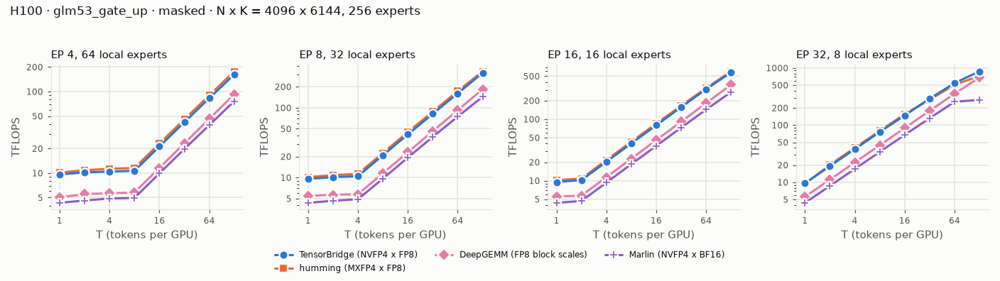
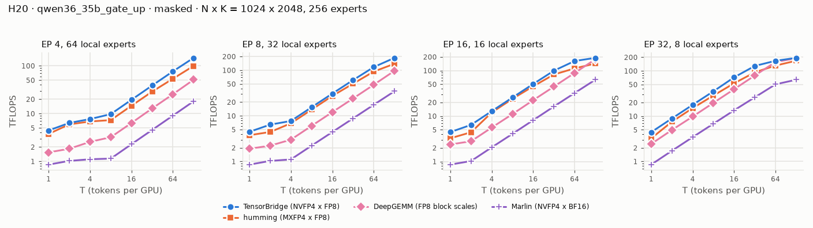
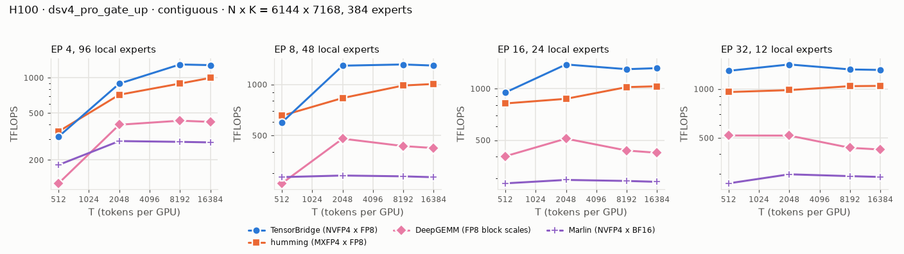
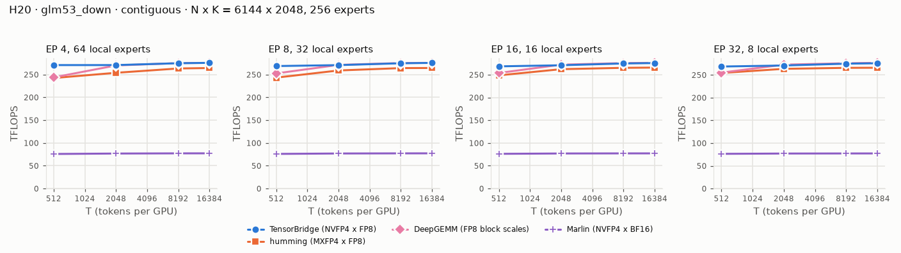

# TensorBridge

TensorBridge is a GEMM library for Hopper GPUs (sm_90a) that keeps weights in NVFP4 (E2M1 codes, one E4M3 scale per
16 values and a per-tensor FP32 scale) and runs them on the FP8 tensor cores. Each weight is dequantized in
registers to FP8 by a short bridge (FPMA: a few PRMT table lookups per four values) and fed to WGMMA as its
register operand, against FP8 E4M3 activations with per-token scales. It covers dense layers and MoE grouped GEMMs
(indexed, contiguous and masked expert layouts), picks a config per shape with a rule per device class, and plugs
into vLLM for linear layers and opt-in NVFP4 routed experts.

It is the kernel library of the USENIX ATC '26 paper *TensorBridge: Bridging Microscaled FP4 Weights to FP8 Tensor
Cores for LLM Serving*. The paper's artifact (evaluation scripts, the vLLM fork it used) is at tag
[`atc26-ae`](https://github.com/revollllt/atc26-tensorbridge/tree/atc26-ae).

## Performance

On H100 SXM and H20, the figures show TFLOPS of TensorBridge and the baselines for dense FFN and
expert-parallel MoE GEMMs.

| | |
| --- | --- |
|  |  |






## Requirements

- A Hopper GPU (sm_90a). The selection rule has device classes for H100 SXM (`NVIDIA H100 80GB HBM3`) and H20
  (`NVIDIA H20`); any other sm_90 device takes the class of the one with the closest SM count, with a warning.
- Python 3.12, PyTorch (tested with 2.13.0 and its Triton), CUDA 12.8 or newer (13 recommended), GCC 11 or newer
  for the C++ launcher.
- Optional: vLLM 0.32.0 (the plugin, `[1, 128]` activation scales and the benchmark baselines), humming-kernels
  0.1.17 (benchmarks).

## Installation

```bash
pip install --no-build-isolation ".[cu13]"          # or ".[cu12]"; -e for development
pip install --no-build-isolation ".[cu13,vllm]"     # with the vLLM plugin
```

The `cu12` / `cu13` extras install NVRTC, the CUDA headers and cuda-python from wheels matching torch's CUDA major
version; without them a system CUDA under `/usr/local/cuda*` is used. The first call builds the C++ launcher
(about a minute) and compiles each kernel with NVRTC (seconds); both are cached on disk.

| Environment variable | Effect |
| --- | --- |
| `TENSORBRIDGE_CACHE_DIR` | kernel, launcher and autotune cache (default `~/.tensorbridge/cache`) |
| `TENSORBRIDGE_AUTOTUNE=1` | the vLLM plugin autotunes the batch sizes vLLM captures in CUDA graphs |
| `TENSORBRIDGE_NUM_SMS` | caps the SMs the kernels use (they otherwise use all SMs of the current stream's context) |

## Usage

### Dense GEMM

```python
import torch
import tensorbridge
from tensorbridge.quant import fp8, nvfp4

w = torch.randn(8192, 8192, dtype=torch.bfloat16, device="cuda")                 # [N, K]
weight = nvfp4.prepare(*nvfp4.quantize(w))         # once per layer: packed codes, scales, global scale -> kernel layout
a, a_scale = fp8.quantize(torch.randn(16, 8192, dtype=torch.bfloat16, device="cuda"))  # FP8 [M, K], FP32 [M, 1]
out = tensorbridge.fp8_nvfp4_gemm(a, a_scale, weight)                            # BF16 [M, N]

layer = tensorbridge.NVFP4Linear.from_float(w)    # a bias-free linear layer; quantizes its input per token
y = layer(torch.randn(16, 8192, dtype=torch.bfloat16, device="cuda"))
```

- `nvfp4.prepare(packed, scale, global_scale=None, clamp_scale=False, bridge="exact")` takes a checkpoint's codes
  (uint8 `[N, K / 2]`), E4M3 scales (`[N, K / 16]`) and global scale (the scale itself; compressed-tensors stores
  its inverse). N must be a multiple of 8 and K of 16; other sizes than multiples of 128 are zero-padded. Raw scale
  bytes above `0x7E` raise unless `clamp_scale=True`.
- `bridge="exact"` (the default) feeds the tensor cores the exact E4M3 rounding of every weight times its scale,
  for standard NVFP4 checkpoints, at a few percent more time; `bridge="fpma"` runs the FPMA approximation, for
  FPMA-aware checkpoints (the paper's). `nvfp4.prepare_experts`, `NVFP4Linear.from_float`,
  `serving.prepare_linear` and `serving.prepare_moe` take `bridge` with the same default; the GEMMs run the bridge
  their weights were prepared for.
- The config is selected from the shape and the device and cached; `config=GemmConfig(...)` pins one
  (`tensorbridge.select_config(m, n, k)` shows the choice).
- `enable_pdl=True` launches with programmatic dependent launch; it pays off right after `fp8.quantize`, which lets
  its dependent launch early, and costs about half a microsecond after other kernels.

### MoE grouped GEMM

```python
experts = nvfp4.prepare_experts(packed, scale, global_scale)   # [E, N, K / 2], [E, N, K / 16], [E]; N, K multiples of 128
out = tensorbridge.fp8_nvfp4_grouped_gemm(a, a_scale, experts, routing, m)
```

One launch computes every expert's rows. `routing` is one of:

- `ContiguousRouting(expert_offsets)`: `a` grouped by expert; expert `e` owns rows `offsets[e]:offsets[e + 1]`
  (int64 `[E + 1]`).
- `MaskedRouting(expert_counts)`: `a` is `E` blocks of `a.size(0) // E` rows; expert `e` owns the first
  `counts[e]` rows of block `e` (int32 `[E]`).
- `IndexedRouting(sorted_ids, expert_ids, num_tokens_padded, block_m, top_k)`: routes sorted by expert and padded
  per tile, as vLLM's `moe_align_block_size` builds them; route `r` reads input row `r // top_k`. `block_m` must
  be the token tile of the selected config: align the routes to
  `tensorbridge.select_config(m, n, k, E, "indexed", top_k=top_k).block_m`.

`m` is the routed row count that selects the config (a hint; the routing itself stays on the device, so the call
can be captured in a CUDA graph). Grouped GEMM never splits K, so its output is deterministic.

### vLLM

```bash
pip install --no-build-isolation ".[cu13,vllm]"
vllm serve MODEL --additional-config '{"tensorbridge":{"linear":true}}'                # NVFP4 linear layers
vllm serve MODEL --additional-config '{"tensorbridge":{"linear":true,"linear_quant":"group_128"}}'  # dense [1, 128] scales
vllm serve MODEL --additional-config '{"tensorbridge":{"linear":true,"exact":false}}'  # FPMA-aware checkpoints
vllm serve MODEL --additional-config '{"tensorbridge":{"linear":true,"moe":true,"moe_dispatch_dtype":"fp8","moe_gate_up_quant":"group_128","moe_down_quant":"group_128"}}'
```

```python
llm = vllm.LLM(MODEL, additional_config={"tensorbridge": {"linear": True, "exact": False}})
```

The plugin registers through `vllm.general_plugins`. The checkpoint keeps its quantization method
(compressed-tensors, ModelOpt NVFP4 or a ModelOpt mixed recipe), which vLLM detects; `--quantization` is not
needed. `additional_config.tensorbridge` chooses the layers TensorBridge serves, as vLLM's `--linear-backend` and
`--moe-backend` choose kernels (vLLM 0.32 accepts only its own names there): `linear` for NVFP4 linear layers,
`moe` for NVFP4 routed experts. Every other layer keeps its native method. `exact` defaults to true for standard
NVFP4 checkpoints; false selects the FPMA table for FPMA-aware weights.

The MoE adapter supports compressed-tensors and ModelOpt NVFP4 (including mixed recipes), independent
per-token/group-128 input quantization for gate/up and down (as well as `linear_quant` for dense layers),
arbitrary vLLM modular MoE activations (with a fused fast path for standard SiLU), DBO, and indexed /
DeepEP HT / DeepEP LL execution. FP8 dispatch requires gate/up group-128; combine remains BF16. It targets
vLLM 0.32.0, Hopper and BF16 input; layers outside its scope (bias, LoRA, EPLB, PP, other EP backends or
non-128-multiple local MoE shapes) fall back to vLLM's native method with a warning.

H100/H20 TP1/2/4 and EP8 checks and standard Qwen3.6 model evaluations completed. Performance includes
HT regressions and LL variability; the results do not establish a speedup for every shape. Formats and
scope are in [`docs/VLLM_MOE.md`](docs/VLLM_MOE.md). Kernel timings are reproduced with
`python benchmarks/compare.py` ([`benchmarks/README.md`](benchmarks/README.md)).

### Autotune (opt-in)

```python
if __name__ == "__main__":       # candidates compile in a spawn process pool
    tensorbridge.autotune([1, 2, 4, 8, 16, 32, 64, 128], n, k)   # before CUDA graph capture of these M
```

For each M a CUDA graph will capture, autotune times the rule's config and up to 15 legal neighbours with weights
streamed from DRAM, keeps a candidate only if it is faster in every round, and serves that M with it from then on;
every other M keeps the rule's choice. `autotune_grouped(ms, n, k, num_experts, top_k, layout)` does the same for
grouped calls. Both take the weights' `bridge` (default `"exact"`): each bridge's kernel is timed and served on its
own. Results are cached on disk per device and source version.

### Experimental

- `tensorbridge.experimental`: `[1, 128]` activation scales (one per token and 128 of K) for dense GEMMs:
  `experimental.quantize(x)` (vLLM's group quantizer, `pip install ".[experimental]"`),
  `experimental.prepare(packed, scale)` (the weight with its scales laid out for this kernel) and
  `experimental.fp8_nvfp4_group_quant_gemm(a, a_scale, weight)`.
- `tensorbridge.serving`: framework-agnostic MoE building blocks (`prepare_moe`, `moe_forward_indexed`,
  `moe_forward_contiguous`, `moe_forward_masked`). The opt-in vLLM MoE adapter uses them, including independent
  per-token/group-128 quantization and fused SiLU-mul/scatter producers.

## Limitations

- Hopper only; BF16 output; FP8 E4M3 activations with per-token FP32 scales (or `[1, 128]` scales, experimental).
- Dense weights: N a multiple of 8, K of 16. Grouped weights: N and K multiples of 128.
- Weight scale bytes at most `0x7E` (`clamp_scale` otherwise); groups with a byte below `0x1C` are zeroed.
- A dense call that the rule splits with Stream-K into three or more slices per tile adds them in arrival order, so
  its output can differ between runs by a few BF16 ULPs; data-parallel and grouped calls are deterministic.
- Selection constants exist for H100 SXM and H20; other sm_90 devices borrow the nearest H100/H20 class by SM count.

## Repository

```text
tensorbridge/        kernels, JIT, quantization, serving, the vLLM plugin, vendored CUTLASS
benchmarks/          kernel timing (`compare.py`, one script per library) and shape sets
docs/images/         README performance figures
docs/VLLM_MOE.md     how to enable the MoE adapter, and the scope it supports
README.md  LICENSE  NOTICE  CONTRIBUTING.md  pyproject.toml
```

See [`CONTRIBUTING.md`](CONTRIBUTING.md) and [`benchmarks/README.md`](benchmarks/README.md).

## Citation

```bibtex
@inproceedings{zou2026tensorbridge,
  title     = {TensorBridge: Bridging Microscaled FP4 Weights to FP8 Tensor Cores for LLM Serving},
  author    = {Zou, Jiaxiang and Chen, Yonghao and Meng, Rui and Wu, Ruilong and Chen, Xinyu},
  booktitle = {Proceedings of the 2026 USENIX Annual Technical Conference (USENIX ATC '26)},
  year      = {2026}
}
```

## License

Apache-2.0 (see [`LICENSE`](LICENSE) and [`NOTICE`](NOTICE)). The vendored CuTe and CUTLASS 4.8.1 headers under
`tensorbridge/third_party/cutlass` are BSD-3-Clause (NVIDIA).
